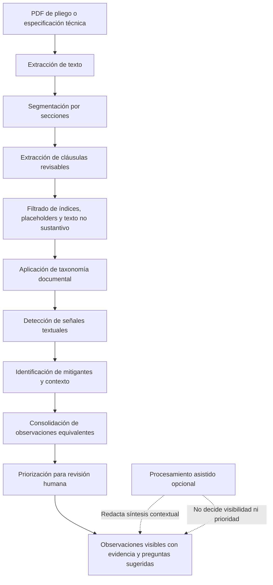

# Integrity Tool

Herramienta exploratoria para revisión documental preliminar de pliegos y especificaciones técnicas en contratación pública.

Integrity Tool ayuda a organizar evidencia, identificar observaciones preliminares y priorizar revisión humana sobre posibles condiciones que podrían afectar concurrencia, proporcionalidad o neutralidad competitiva.

No detecta corrupción, no determina ilegalidad, no asigna responsabilidades y no reemplaza revisión técnica, jurídica ni institucional.

## Objetivo

La herramienta busca responder:

> ¿Qué aspectos de este pliego convendría revisar primero y por qué?

Para eso combina extracción documental, reglas determinísticas, una taxonomía editable de señales y, cuando está configurado, procesamiento asistido para redactar resúmenes o explicaciones contextuales.

## Cómo funciona

El flujo principal es determinístico:

1. Extrae texto del PDF con PyMuPDF y usa OCR como respaldo si está disponible.
2. Segmenta el documento en secciones y cláusulas revisables.
3. Filtra texto no sustantivo, placeholders, índices y boilerplate.
4. Aplica una taxonomía YAML de señales documentales.
5. Detecta mitigantes como equivalencias, justificaciones técnicas o requisitos regulatorios habituales.
6. Consolida observaciones equivalentes para evitar duplicados.
7. Prioriza revisión humana como `revisión general`, `revisión sugerida` o `revisión prioritaria`.
8. Muestra evidencia textual y visual asociada a cada observación.

El LLM es opcional y solo apoya la síntesis contextual y redacción de explicaciones. La metadata del encabezado, detección, consolidación, visibilidad y prioridad se resuelven sin modelos de lenguaje. Un fallo del proveedor no elimina los resultados documentales.

### Cursograma general



## Qué analiza

La herramienta puede revisar PDFs de pliegos y especificaciones técnicas. La taxonomía actual incluye señales relacionadas con:

- referencias a marcas, modelos, tecnologías o fabricantes;
- requisitos de autorización, certificación, trazabilidad o respaldo del bien;
- especificaciones técnicas altamente prescriptivas;
- experiencia o capacidad potencialmente excesiva;
- requisitos financieros potencialmente restrictivos;
- cronogramas, plazos de preguntas, ofertas, entrega o ejecución;
- visitas técnicas obligatorias;
- restricciones territoriales o presencia local;
- interoperabilidad, compatibilidad o continuidad operativa;
- documentación administrativa excesiva;
- alineamiento de especificaciones con presentaciones, modelos, SKU o productos comerciales específicos.

Estas dimensiones son una propuesta metodológica inicial y pueden ajustarse mediante la taxonomía.

## Instalación

macOS / Linux:

```bash
python3 -m venv .venv
source .venv/bin/activate
pip install -r requirements.txt
cp .env.example .env
```

Windows PowerShell:

```powershell
py -m venv .venv
.\.venv\Scripts\Activate.ps1
python -m pip install -r requirements.txt
copy .env.example .env
```

Si PowerShell bloquea la activación, no es necesario cambiar la política del equipo. Use el ejecutable del entorno directamente:

```powershell
.\.venv\Scripts\python.exe -m pip install -r requirements.txt
.\.venv\Scripts\python.exe -m streamlit run app.py
```

La aplicación funciona sin configurar un LLM. En ese caso se muestran resultados basados en reglas, taxonomía y comparación documental local cuando exista corpus disponible.

OCR en Windows es opcional. Solo hace falta instalar Tesseract si se van a analizar PDFs escaneados como imagen. Para PDFs con texto seleccionable no es necesario.

## Ejecución Local

### Mesa documental nueva: React + PDF.js

Conserva el motor Python y agrega una API local ligera. Permite revisar un expediente con pliego, especificaciones, anexos y versiones, navegar evidencia en un PDF real y guardar estados y comentarios.

Requiere Python 3.11 o superior, Node.js 22.13 o superior (recomendado: 24) y pnpm 11.25. Desde la raíz del proyecto, con el entorno virtual activado:

```bash
python -m pip install -r requirements-workbench.txt
cd frontend
pnpm install --frozen-lockfile
pnpm build
cd ..
python run_workbench.py
```

Abra [la mesa documental local](http://127.0.0.1:8000). Los mismos comandos funcionan en PowerShell después de activar `.venv`.

Si no tiene pnpm, puede instalar la versión utilizada con `npm install --global pnpm@11.25.0`. No se requiere Node para ejecutar Python después de construir el frontend.

Los originales, resultados y revisiones se guardan en `data/workbench/reviews.sqlite3`, fuera de Git. Navegar, cambiar zoom, registrar revisión y exportar no repiten el análisis ni solicitan contenido al LLM. Las versiones sustituidas deben indicarse explícitamente al cargar; no se infieren por nombre de archivo. El contraste identifica diferencias textuales, no contradicciones jurídicas.

Cada revisión nueva conserva la copia exacta de su taxonomía en esa base. La misma copia se utiliza en todos los documentos, en el corpus y en la contextualización asistida; puede descargarse desde «Alcance y trazabilidad de esta lectura». Editar el YAML no modifica revisiones anteriores. El cotejo entre versiones considera todas las evidencias identificadas, no solo el fragmento representativo; mover o repetir un fragmento en otra página no se presenta como cambio de su contenido.

**Alcance de despliegue:** esta mesa es un piloto local de un solo servidor, sin autenticación institucional. No exponga el puerto en Internet ni en una red compartida. La identidad `Revisor local` es una etiqueta, no una identidad verificada. Antes de un despliegue compartido se necesitan autenticación, permisos, retención, respaldo y pruebas de concurrencia.

### Streamlit: compatibilidad existente

```bash
python -m streamlit run app.py
```

Luego abra la URL local que indique Streamlit, usualmente `http://localhost:8501`.

Usar `python -m streamlit` evita problemas de rutas internas del entorno virtual en Windows, macOS y Linux.

Streamlit sigue disponible y conserva compatibilidad con Community Cloud. La nueva mesa React/API requiere otro entorno de despliegue; no reemplaza automáticamente la aplicación publicada.

## Configuración LLM Opcional

Edite `.env` solo si desea habilitar procesamiento asistido.

En la mesa nueva se permiten por defecto **dos solicitudes lógicas por expediente**: una síntesis y la explicación del primer aspecto. Se guardan también los fallos para evitar reintentos al navegar. Cada solicitud tiene límite de salida y timeout, sin reintentos implícitos del SDK. El proveedor puede facturar una solicitud fallida o interrumpida; el límite no es una estimación monetaria.

```env
INTEGRITY_ASSISTED_ENABLED=true
INTEGRITY_LLM_MAX_CALLS=2
# Opcional: cambiar la ubicación de la base local
# INTEGRITY_STORE_PATH=data/workbench/reviews.sqlite3
```

Use `INTEGRITY_ASSISTED_ENABLED=false` para mantener todo el flujo determinístico. Las respuestas utilizadas registran proveedor, modelo, versión y huella de prompt, tiempo y consumo reportado por el proveedor. No se almacenan claves ni deliberaciones del modelo. La redacción asistida no verifica hechos externos por sí sola.

OpenAI directo:

```env
OPENAI_API_KEY=...
OPENAI_MODEL=gpt-4o-mini
```

Azure OpenAI:

```env
OPENAI_API_KEY=...
OPENAI_BASE_URL=https://your-resource.openai.azure.com/
OPENAI_API_VERSION=2024-06-01
OPENAI_MODEL=gpt-4o-mini
```

Groq:

```env
GROQ_API_KEY=...
GROQ_MODEL=llama-3.3-70b-versatile
```

Ollama local:

```env
OLLAMA_BASE_URL=http://localhost:11434/v1
OLLAMA_MODEL=llama3.1
```

## Corpus Documental Opcional

Para comparar contra procesos previamente analizados se puede usar esta estructura:

```text
data/
  raw/
    metadata/
      procesos.csv
    pliegos/
    especificaciones/
  processed/
    extracted_text/
```

El CSV `procesos.csv` puede incluir:

- `process_id`
- `entidad`
- `objeto`
- `fecha`
- `pliego_file`
- `especificaciones_file`

Los archivos en `data/` no se versionan por defecto. Esto evita publicar PDFs o corpus locales accidentalmente.

## Estructura Principal

```text
app.py
run_workbench.py
requirements-workbench.txt
frontend/
  src/
  pnpm-lock.yaml
assets/styles.css
pages/Ayuda.py
src/analyzer/
  review_pipeline.py
  workbench_service.py
  review_store.py
  case_review.py
  detector.py
  prioritizer.py
  llm_reviewer.py
  observation_filter.py
  schedule_analyzer.py
  patterns/risk_taxonomy.yaml
src/workbench_api.py
docs/
  architecture.md
  technical_and_conceptual_framework.md
tests/
```

Los archivos `agent.py`, `agent_runner.py`, `db.py` y `tools.py` son experimentales y no participan en ninguna de las dos interfaces. No son parte del motor institucional compartido.

## Validación

```bash
python -m compileall -q app.py src tests pages run_workbench.py
python -m pytest -q
cd frontend
pnpm build
```

La suite cubre metadata y verificación por contenido, negaciones, equivalencias locales, conservación de páginas, requisitos habituales, motor compartido, caché versionada, copias verificables de la taxonomía, cotejo de todas las evidencias entre versiones, expediente, estados persistentes, API y exportaciones. Las pruebas de API requieren `requirements-workbench.txt`. Las pruebas de redacción asistida utilizan respuestas simuladas y no necesitan consumir recursos del proveedor.

Cada análisis exporta la huella SHA-256 del documento, la versión del motor, la versión y huella de la taxonomía y la fecha de ejecución. Estos datos permiten identificar qué documento y reglas produjeron una observación.

## Referencias conceptuales y metodológicas

La arquitectura conceptual, los principios analíticos, el enfoque metodológico y los lineamientos de gobernanza se documentan en:

- [Marco técnico y conceptual](docs/technical_and_conceptual_framework.md)
- [Arquitectura del pipeline documental](docs/architecture.md)
- [Decisiones de UX y transición a mesa documental](docs/workbench_ux.md)

Estos documentos explican el enfoque de neutralidad competitiva, trazabilidad, revisión humana, corpus histórico, uso prudente de LLM y mitigación de falsos positivos.

## Alcance

Integrity Tool es una herramienta exploratoria de apoyo analítico documental. Sus observaciones son insumos preliminares para revisión humana y deben interpretarse junto con el expediente, normativa aplicable, mercado relevante, necesidad institucional y criterio técnico-jurídico competente.

No es una herramienta oficial del SERCOP ni representa una posición institucional.
