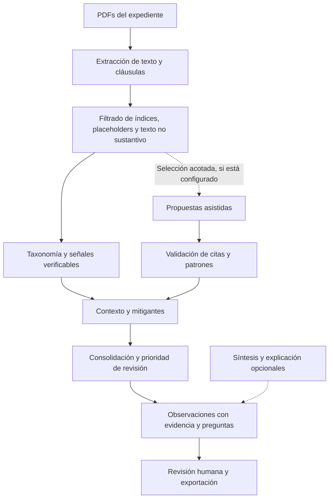

# Integrity Tool

Herramienta exploratoria de revisión documental de pliegos, especificaciones y anexos de contratación pública. Organiza evidencia y aspectos sugeridos para revisión humana.

> ¿Qué aspectos de este pliego convendría revisar primero y por qué?

La aplicación tiene una sola interfaz: **React + TypeScript + PDF.js**, servida por una **API Python/FastAPI**. El motor combina reglas y una taxonomía editable con procesamiento asistido opcional. No detecta corrupción, no determina ilegalidad ni reemplaza revisión técnica, jurídica o institucional.

## Inicio rápido

Requisitos: Python 3.11 o superior, Node.js 22.13 o superior (recomendado: 24) y pnpm 11.25. Node solo es necesario para construir la interfaz. Si falta pnpm: `npm install --global pnpm@11.25.0`.

Desde la raíz del repositorio, cree y active el entorno:

**macOS / Linux**

```bash
python3 -m venv .venv
source .venv/bin/activate
```

**Windows PowerShell**

```powershell
py -m venv .venv
.\.venv\Scripts\Activate.ps1
```

Luego, en cualquiera de los sistemas:

```bash
python -m pip install -r requirements.txt
cd frontend
pnpm install --frozen-lockfile
pnpm build
cd ..
python run_workbench.py
```

Abra [Integrity Tool en local](http://127.0.0.1:8000). Para volver a iniciarla, active el entorno y ejecute `python run_workbench.py`. Reconstruya el frontend después de modificar su código.

Si PowerShell bloquea la activación, no cambie la política del equipo: use `.\.venv\Scripts\python.exe` en lugar de `python`.

No se necesita una clave de modelos para iniciar la aplicación ni ejecutar el motor determinístico. Para habilitar procesamiento asistido, cree un `.env` a partir de [.env.example](.env.example) sin sobrescribir una configuración existente. Consulte [proveedores, corpus y almacenamiento](docs/configuration.md).

## Uso

1. Cargue el pliego y, si corresponde, especificaciones, anexos o adendas.
2. Indique los tipos documentales y las sustituciones de versiones de forma explícita.
3. Inicie la revisión y consulte el resumen y las observaciones consolidadas.
4. Abra la evidencia en el PDF; registre revisión, descarte, seguimiento o comentario.
5. Exporte el resultado existente en HTML, CSV o JSON.

Se admiten hasta ocho PDFs, de hasta 25 MB cada uno y 100 MB por expediente. Los PDFs con texto seleccionable no necesitan OCR. Para documentos escaneados se requiere Tesseract con el idioma correspondiente, instalado por separado; una extracción incompleta se informa como lectura parcial.

Los originales, resultados, comentarios y copias de la taxonomía se guardan en `data/workbench/reviews.sqlite3`, fuera de Git. Navegar, cambiar zoom, revisar y exportar no repite el análisis ni vuelve a solicitar contenido al proveedor.

## Cómo funciona



La unidad visible es una observación consolidada, no cada coincidencia textual. Repetir una cláusula no aumenta su prioridad. Los requisitos habituales, mitigantes y frecuencias históricas contextualizan la lectura; no acreditan por sí solos la validez de una exigencia.

La taxonomía incluye condiciones técnicas, autorizaciones, certificaciones, experiencia, requisitos financieros, plazos, presencia local, interoperabilidad y combinaciones de especificaciones. Es una propuesta metodológica inicial editable en [el catálogo YAML](src/analyzer/patterns/risk_taxonomy.yaml).

Cada revisión conserva la taxonomía exacta utilizada y su huella SHA-256. Editar el catálogo no modifica resultados anteriores. Las versiones sustituidas se mantienen para consulta, pero no se presentan como requisitos vigentes. El contraste identifica diferencias textuales, no contradicciones jurídicas.

## Procesamiento asistido

Si hay un proveedor configurado, la aplicación puede proponer candidatos con citas verificables y redactar una síntesis contextual. El modelo no asigna la prioridad final. Comprobar una cita no valida su interpretación: se necesita revisión humana.

Por defecto se permiten dos solicitudes lógicas por expediente: propuestas semánticas y síntesis si hay observaciones visibles. Se seleccionan hasta 24 cláusulas activas y 12.000 caracteres de texto. La interfaz muestra cobertura y límites; no se presupone lectura exhaustiva.

Los resultados y los fallos se conservan para evitar reintentos al navegar. Un fallo del proveedor no elimina el resultado determinístico. Se registra proveedor, modelo, versiones, cobertura y consumo reportado, sin claves ni deliberaciones internas. Consulte [configuración y límites](docs/configuration.md).

## Estructura

```text
run_workbench.py                 Inicio local
requirements.txt                Dependencias de ejecución
requirements-dev.txt            Ejecución + herramientas de pruebas
frontend/                       Interfaz React/TypeScript y PDF.js
src/workbench_api.py             API, originales y exportaciones
src/config.py                   Configuración del motor y corpus
src/analyzer/
  review_pipeline.py            Pipeline documental compartido con el corpus
  workbench_service.py          Ejecución y asistencia acotada
  review_store.py               Persistencia SQLite
  case_review.py                Consolidación del expediente y versiones
  patterns/risk_taxonomy.yaml    Catálogo de revisión
tests/                          Pruebas de motor, API y contratos
docs/                           Arquitectura, metodología y evaluación
data/                           Datos locales, no versionados
```

Las interfaces y notificaciones anteriores se retiraron; su código es recuperable en el historial Git. No hay un segundo comando de ejecución ni un segundo frontend soportado.

## Validación

```bash
python -m pip install -r requirements-dev.txt
python -m pip check
python -m compileall -q src tests run_workbench.py
python -m pytest -q
cd frontend
pnpm build
```

La suite cubre extracción, metadata, negaciones, mitigantes, consolidación, trazabilidad, versiones, caché, persistencia, API y exportaciones. Los casos asistidos utilizan respuestas simuladas; las pruebas bloquean conexiones HTTP externas para no consumir claves locales. CI verifica Python 3.11/3.13 en Linux y Windows, y la construcción del frontend.

## Despliegue

Esta versión es un piloto local de un solo servidor y un trabajador, sin autenticación institucional. No exponga el puerto en Internet ni en una red compartida. `Revisor local` es una etiqueta, no una identidad verificada.

Para publicarla en Azure u otro entorno compartido se deben resolver acceso autenticado, permisos, dominio autorizado, persistencia, respaldos, retención y pruebas de concurrencia. No es suficiente cambiar la dirección de escucha. La configuración del proveedor no equivale a un despliegue seguro.

## Documentación

- [Configuración: proveedores, corpus y almacenamiento](docs/configuration.md)
- [Arquitectura del pipeline documental](docs/architecture.md)
- [Marco técnico y conceptual](docs/technical_and_conceptual_framework.md)
- [Protocolo inicial de evaluación de la PoC](docs/poc_evaluation.md)
- [Decisiones de UX de la mesa documental](docs/workbench_ux.md)

## Alcance

Las observaciones son insumos preliminares. Se interpretan junto con el expediente, la normativa aplicable, el mercado y el criterio técnico-jurídico competente. Las pruebas sintéticas no demuestran precisión institucional: se requiere evaluación con especialistas de SERCOP.

Integrity Tool no es una herramienta oficial del SERCOP ni representa una posición institucional. Revise también las condiciones de licencia de sus dependencias antes de distribuirla o desplegarla institucionalmente.
