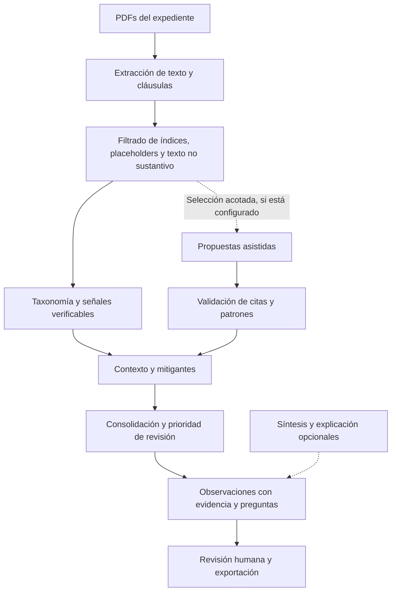

# Integrity Tool

Herramienta exploratoria de revisión documental de pliegos, especificaciones y anexos de contratación pública. Organiza evidencia y aspectos sugeridos para revisión humana.

> ¿Qué aspectos de este pliego convendría revisar primero y por qué?

La aplicación utiliza **React + TypeScript + PDF.js**, servida por una **API Python/FastAPI**. El motor combina reglas y una taxonomía editable con procesamiento asistido opcional. No detecta corrupción, no determina ilegalidad ni reemplaza revisión técnica, jurídica o institucional.

**Entrega para Azure:** comenzar por [la guía para el desarrollador](docs/developer_handoff.md): componentes, configuración, datos y criterios de aceptación.

**Motor de IA:** [dónde, cómo y cuándo interviene](docs/ai_engine.md), datos enviados, límites, fallos y comprobación del uso efectivo de Azure OpenAI.

## Inicio rápido

Requisitos: Python 3.11 o superior, Node.js 22.13 o superior (recomendado: 24) y pnpm 11.25. Node solo es necesario para construir la interfaz. Si falta pnpm: `npm install --global pnpm@11.25.0`.

Desde la raíz del repositorio, cree y active el entorno:

**macOS / Linux**

```bash
python3 -m venv .venv
source .venv/bin/activate
```

**Windows PowerShell**

```powershell
py -m venv .venv
.\.venv\Scripts\Activate.ps1
```

Luego, en cualquiera de los sistemas:

```bash
python -m pip install -r requirements.txt
cd frontend
pnpm install --frozen-lockfile
pnpm build
cd ..
python run_workbench.py
```

Abra [Integrity Tool en local](http://127.0.0.1:8000). Para volver a iniciarla, active el entorno y ejecute `python run_workbench.py`. Reconstruya el frontend después de modificar su código.

Si PowerShell bloquea la activación, no cambie la política del equipo: use `.\.venv\Scripts\python.exe` en lugar de `python`.

No se necesita una clave de modelos para iniciar la aplicación ni ejecutar el motor determinístico. Para habilitar procesamiento asistido, cree un `.env` a partir de [.env.example](.env.example) sin sobrescribir una configuración existente. Consulte [proveedores, corpus y almacenamiento](docs/configuration.md).

## Uso

1. Cargue el pliego o busque el proceso en SERCOP por año y palabras clave, con filtros opcionales de comprador/proveedor o consulta directa por OCID. Los campos desplegables permiten escribir texto y reutilizar búsquedas de la sesión; los filtros se envían a la API oficial. La ficha permite vincular los PDF mediante confirmación humana; no los descarga automáticamente.
2. Indique los tipos documentales y las sustituciones de versiones de forma explícita.
3. Inicie la revisión y consulte el resumen y las observaciones consolidadas.
4. Abra la evidencia en el PDF; registre revisión, descarte, seguimiento o comentario.
5. Exporte el resultado existente en HTML, CSV o JSON.

En **Contrastar condiciones**, consulte valores explícitos comparables entre
documentos: RAM, almacenamiento, peso y determinados plazos. Cada comparación
conserva sus citas y páginas. El cotejo se abstiene cuando no puede vincular el
mismo ítem, unidad o hito; una diferencia no constituye una contradicción ni
genera automáticamente una observación priorizada. Consulte su
[alcance inicial y limitaciones](docs/requirements_comparison.md).

Se admiten hasta ocho PDFs, de hasta 25 MB cada uno y 100 MB por expediente. Los PDFs con texto seleccionable no necesitan OCR. Para documentos escaneados se requiere Tesseract con el idioma correspondiente, instalado por separado; una extracción incompleta se informa como lectura parcial.

En local, los resultados, comentarios y copias de taxonomía se guardan en `data/workbench/reviews.sqlite3`; los originales nuevos, en `data/workbench/documents/`. Los originales de revisiones anteriores siguen disponibles desde su almacenamiento previo. Todo queda fuera de Git. Navegar, cambiar zoom, revisar y exportar no repite el análisis ni vuelve a solicitar contenido al proveedor.

Para almacenamiento compartido, la aplicación admite PostgreSQL y Azure Blob Storage, con trabajos persistentes y un proceso de análisis separado. Consulte [almacenamiento compartido y migración](docs/shared_storage.md).

## Cómo funciona



La unidad visible es una observación consolidada, no cada coincidencia textual. Repetir una cláusula no aumenta su prioridad. Los requisitos habituales, mitigantes y frecuencias históricas contextualizan la lectura; no acreditan por sí solos la validez de una exigencia.

La taxonomía incluye condiciones técnicas, autorizaciones, certificaciones, experiencia, requisitos financieros, plazos, presencia local, interoperabilidad y combinaciones de especificaciones. Es una propuesta metodológica inicial editable en [el catálogo YAML](src/analyzer/patterns/risk_taxonomy.yaml).

Cada revisión conserva la taxonomía exacta utilizada y su huella SHA-256. Editar el catálogo no modifica resultados anteriores. Las versiones sustituidas se mantienen para consulta, pero no se presentan como requisitos vigentes. El contraste identifica diferencias textuales, no contradicciones jurídicas.

## Procesamiento asistido

Si hay un proveedor configurado, la aplicación puede proponer candidatos con citas verificables y redactar una síntesis contextual. El modelo no asigna la prioridad final. Comprobar una cita no valida su interpretación: se necesita revisión humana.

Por defecto se permiten dos solicitudes lógicas por expediente: propuestas semánticas y síntesis si hay observaciones visibles. Se seleccionan hasta 24 cláusulas activas y 12.000 caracteres de texto. La interfaz muestra cobertura y límites; no se presupone lectura exhaustiva.

Los resultados y los fallos se conservan para evitar reintentos al navegar. Una reserva persistente evita repetir automáticamente solicitudes cuya respuesta quedó incierta. Un fallo del proveedor no elimina el resultado determinístico. Se registra proveedor, modelo, versiones, cobertura y consumo reportado, sin claves ni deliberaciones internas. Consulte [configuración y límites](docs/configuration.md).

## Estructura

```text
run_workbench.py                 Inicio local
requirements.txt                Dependencias de ejecución
requirements-dev.txt            Ejecución + herramientas de pruebas
requirements-azure.txt          Dependencias con adaptadores PostgreSQL/Blob
Dockerfile                      Imagen de API/trabajador, sin datos ni secretos
deploy/azure/                   Contratos de variables del ambiente
frontend/                       Interfaz React/TypeScript y PDF.js
src/workbench_api.py             API, originales y exportaciones
src/config.py                   Configuración del motor y corpus
src/analyzer/
  review_pipeline.py            Pipeline documental compartido con el corpus
  workbench_service.py          Ejecución y asistencia acotada
  review_store.py               Datos, resultados y trabajos transaccionales
  storage_schema.py             Esquema SQLite/PostgreSQL versionado
  document_storage.py           Originales por huella: archivos o Blob
  review_worker.py              Reserva y ejecución de trabajos
  case_review.py                Consolidación del expediente y versiones
  patterns/risk_taxonomy.yaml    Catálogo de revisión
tests/                          Pruebas de motor, API y contratos
src/manage_storage.py           Inicialización y migración explícitas
src/review_worker.py            Inicio del trabajador independiente
src/deployment_check.py          Comprobaciones sin análisis ni modelos
src/assistance_check.py          Configuración y prueba explícita del modelo con datos ficticios
docs/                           Arquitectura, metodología y evaluación
benchmarks/                     Evaluación aislada de extracción documental
data/                           Datos locales, no versionados
```

## Validación

```bash
python -m pip install -r requirements-dev.txt
python -m pip check
python -m compileall -q src tests benchmarks run_workbench.py
python -m pytest -q
cd frontend
pnpm build
```

La suite cubre extracción, metadata, negaciones, mitigantes, consolidación, trazabilidad, versiones, caché, persistencia, API y exportaciones. Los casos asistidos utilizan respuestas simuladas; las pruebas bloquean HTTP externo para no consumir claves locales. CI verifica Python 3.11/3.13 en Linux y Windows, el frontend y la integración con PostgreSQL y Blob emulado. Las pruebas externas requieren [servicios de prueba explícitos](docs/shared_storage.md); nunca utilizan cuentas de Azure reales.

Para comparar fidelidad documental antes de cambiar el extractor, consulte el [benchmark de extracción](docs/document_benchmark.md). Congela una muestra por SHA-256 y conserva mediciones y evidencias; se ejecuta por separado de la aplicación. La comparación local no utiliza modelos ni servicios externos.

El benchmark también prepara un cuaderno con originales y páginas seleccionadas, sin respuestas precargadas, para anotación independiente y resolución de referencias expertas.

## Despliegue

El inicio local integra API y trabajador. El contenedor permite ejecutarlos por separado y conserva los trabajos en la base de datos. El Dockerfile construye el frontend e incorpora Python y OCR.

**Acceso Azure incluido:** el perfil `entra` incorpora validación de identidad firmada de Microsoft Entra, roles de consulta/revisión, protección de originales y exportaciones y registro del actor verificado. El desarrollador configura Container Apps, Easy Auth, token store, usuarios, secretos y HTTPS siguiendo [la guía de acceso](docs/azure_access.md), sin editar código. La política es un espacio compartido por un equipo autorizado, no expedientes privados por usuario. El modo local conserva loopback.

La [guía de Azure](docs/azure_deployment.md) detalla construcción, arranque, servicios y aceptación. Sustituya los marcadores de los ejemplos por los valores del ambiente y suministre secretos mediante la plataforma. Los documentos y las bases se administran fuera de la imagen.

## Documentación

- [Entrega al desarrollador](docs/developer_handoff.md)
- [Motor de IA: ejecución, datos, límites y verificación](docs/ai_engine.md)
- [Preparación, datos y aceptación en Azure](docs/azure_deployment.md)
- [Acceso institucional, roles y configuración de Entra](docs/azure_access.md)
- [Configuración: proveedores, corpus y almacenamiento](docs/configuration.md)
- [Persistencia compartida, trabajos y migración](docs/shared_storage.md)
- [Arquitectura del pipeline documental](docs/architecture.md)
- [Requisitos verificables y cotejo de condiciones entre documentos](docs/requirements_comparison.md)
- [Búsqueda SERCOP, procedencia y alcance documental](docs/sercop_ocds.md)
- [Marco técnico y conceptual](docs/technical_and_conceptual_framework.md)
- [Protocolo inicial de evaluación de la PoC](docs/poc_evaluation.md)
- [Benchmark reproducible de extracción documental](docs/document_benchmark.md)
- [Decisiones de UX de la mesa documental](docs/workbench_ux.md)

## Alcance

Las observaciones son insumos preliminares. Se interpretan junto con el expediente, la normativa aplicable, el mercado y el criterio técnico-jurídico competente. Las pruebas sintéticas no demuestran precisión institucional: se requiere evaluación con especialistas de SERCOP.

Integrity Tool no es una herramienta oficial del SERCOP ni representa una posición institucional. Revise también las condiciones de licencia de sus dependencias antes de distribuirla o desplegarla institucionalmente.
