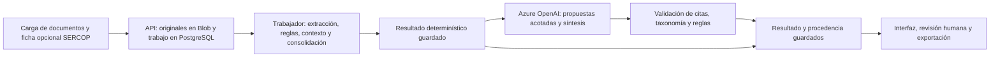

# Motor de IA: dónde, cómo y cuándo interviene

Contrato operativo de la versión actual. La configuración habilitada no demuestra
que se haya realizado una llamada: hay que comprobar el resultado del expediente.

## 1. Dónde se ejecuta

En Azure, las solicitudes a Azure OpenAI salen del **trabajador Python**, no del
navegador ni de la API que recibe los archivos. El trabajador utiliza
`src/analyzer/workbench_service.py`; el cliente y los contratos de respuesta están
en `src/analyzer/llm_reviewer.py`. Las claves se suministran únicamente al trabajador.

En local, `python run_workbench.py` integra ese trabajador en el mismo proceso.
La interfaz utiliza resultados persistidos; no llama directamente al proveedor.



## 2. Qué hace cada etapa

| Etapa | Implementación | ¿Usa el modelo? | Resultado |
|---|---|---|---|
| Lectura del PDF y OCR | `pdf_extractor.py`, `parser.py` | No | Texto, páginas y estado de extracción. Tesseract procesa OCR. |
| Segmentación, cláusulas y filtrado | `document_segmenter.py`, `clause_extractor.py`, `boilerplate_filter.py` | No | Cláusulas revisables; exclusiones conservadas para auditoría. |
| Señales, mitigantes, consolidación y prioridad | `review_pipeline.py` y módulos del motor | No | Observaciones con evidencia y criterios explícitos. |
| Metadata administrativa | `metadata_extractor.py`, ficha OCDS vinculada | No | Campos extraídos o publicados; no se reescriben con el modelo. |
| Frecuencia histórica | `WorkbenchService._corpus_context` | No | Contexto del corpus validado, con exclusión del propio proceso. |
| Propuestas semánticas | `_analyze_semantics`, `semantic_analyzer.py` | Sí, si está habilitado y hay contexto elegible | Hasta cuatro candidatos ligados a cláusulas y patrones existentes. |
| Síntesis contextual | `_narrate`, `generate_document_brief` | Sí, si queda presupuesto y hay observaciones | Redacción sobre los primeros tres aspectos; no una segunda ficha administrativa. |
| Explicación individual | `_narrate`, `explain_priority_with_llm` | Sí, si queda presupuesto después de la síntesis | Explicación de una observación existente. No altera su prioridad. |
| Cotejo de condiciones, consulta SERCOP, navegación y exportación | `requirements.py`, `sercop_ocds.py`, API e interfaz | No | Comparaciones explícitas y consulta de resultados existentes. |

Los helpers de metadata asistida en `llm_reviewer.py` **no forman parte de la
ejecución actual del workbench**. Tampoco hay consulta automática del mercado,
búsqueda web mediante el modelo ni comprobación de exclusividad comercial.
El contraste de condiciones entre documentos no es una lectura semántica
exhaustiva del expediente.

## 3. Cuándo se solicita el modelo

1. El usuario inicia una revisión. La API registra un trabajo persistente.
2. El trabajador extrae y analiza los documentos y guarda el resultado basado en reglas.
3. Si `INTEGRITY_ASSISTED_ENABLED=true`, hay proveedor válido y presupuesto,
   selecciona contexto y solicita propuestas semánticas, salvo que
   `INTEGRITY_SEMANTIC_ENABLED=false`.
4. Comprueba candidatos y vuelve a aplicar contextualización, consolidación,
   filtros de relevancia y prioridad determinísticos.
5. Si hay observaciones y queda presupuesto, solicita la síntesis y, después,
   explicaciones individuales hasta agotar el límite.
6. Conserva resultados y estados. La pantalla puede mostrar la lectura basada en
   reglas mientras termina la asistencia; `ready` por sí solo no prueba que terminó la IA.

No se solicitan modelos al abrir una revisión guardada, navegar páginas, ampliar
el PDF, comentar o exportar. Una caché reutilizada no implica una nueva llamada.
Una nueva revisión o un cambio de documentos, reglas o configuración puede
necesitar nuevas solicitudes.

## 4. Qué información sale hacia Azure OpenAI

- **Propuestas:** selección de hasta 24 cláusulas activas, hasta 12.000 caracteres
  de texto fuente y un contexto serializado de hasta 19.000 caracteres. Cada
  cláusula lleva nombre/identificador del documento, versión, rol, página y sección,
  junto con una selección de la taxonomía archivada. No se envían cláusulas de más
  de 1.600 caracteres; la cobertura indica lo omitido.
- **Síntesis:** primeras tres observaciones, sus fragmentos representativos,
  mitigantes, prioridad ya calculada y referencias de taxonomía/contexto disponibles.
- **Explicación:** datos equivalentes de una observación, no el PDF completo.

No se envían los binarios PDF, la base completa, las credenciales, el historial de
comentarios ni todo el corpus. **El texto y los nombres seleccionados no se
anonimizan automáticamente**: pueden contener datos personales o información
institucional. El responsable debe autorizar su tratamiento y revisar región,
deployment, conectividad, condiciones del proveedor y retención aplicables.

## 5. Qué se valida y qué no

Los candidatos deben usar patrones y cláusulas enviados, citar texto verificable,
superar controles de contenido sustantivo, negación, duplicación y lenguaje, y
tener confianza admitida. Después se aplican las reglas del motor: una propuesta
aceptada puede quedar excluida de la lista visible.

El modelo puede **proponer una observación que no detectaron las reglas**; no es
solo un redactor. No puede crear una categoría libre ni asignar prioridad final.
Validar una cita comprueba su origen, **no demuestra que su interpretación sea
correcta**. No hay garantía de exhaustividad ni de ausencia de falsos positivos.
La decisión y la validación técnica/jurídica corresponden al revisor humano.

## 6. Configuración y costo

Aplicar [el contrato del trabajador](../deploy/azure/worker.env.example). La API
utiliza [su propio contrato](../deploy/azure/api.env.example), sin clave del modelo.
`OPENAI_MODEL` es el **nombre del deployment**, no una licencia ni necesariamente
el nombre comercial del modelo. Tener acceso a Azure OpenAI no crea el deployment
ni asigna cuota; lo configura el equipo de la suscripción.

| Configuración | Máximo lógico habitual cuando hay contexto y observaciones |
|---|---|
| Asistencia desactivada o límite 0 | Sin solicitudes. |
| Semántica activa, límite 1 | Propuestas semánticas; sin síntesis posterior si se consume la solicitud. |
| Semántica activa, límite 2 (referencia) | Propuestas + síntesis. No explica cada observación con una llamada individual. |
| Semántica activa, límite 3 | Propuestas + síntesis + explicación de la primera observación. |
| Semántica desactivada, límite 2 | Síntesis + explicación de la primera observación. |

Los pasos sin contexto elegible no consumen su solicitud; las respuestas
reutilizadas sí ocupan una entrada lógica del resultado, pero no una nueva
solicitud al proveedor. El límite no es un presupuesto monetario global.
Cada petición tiene timeout de 20 segundos, salida de hasta 1.600 tokens y
reintentos del cliente desactivados. Un fallo o corte puede ser facturable.
Configurar cuotas, presupuesto y alertas globales en Azure por separado.

La compatibilidad depende del deployment y de la versión de API: se utiliza
Chat Completions con JSON Schema y `max_completion_tokens`. Revisar los
[requisitos de salidas estructuradas de Microsoft](https://learn.microsoft.com/en-us/azure/ai-services/openai/how-to/structured-outputs)
y ejecutar la prueba sintética antes de aprobar el ambiente. No cambiar de modelo
solo por disponibilidad sin evaluar calidad y latencia.

## 7. Cómo comprobar que intervino

Consultar el resultado autenticado de `GET /api/cases/{case_id}` o su exportación JSON:

| Campo | Interpretación |
|---|---|
| `result.assistance.calls[].purpose` | `semantic_analysis`, `summary` o `explanation`. |
| `status=completed` | Respuesta recibida y validada por el contrato; no aprobación humana. |
| `cached=true` | Respuesta reutilizada: no acredita consumo nuevo en esta revisión. |
| `provider`, `model`, `response_id` | Proveedor y deployment utilizados, e identificador si fue reportado. |
| `input_tokens`, `output_tokens`, `elapsed_ms` | Consumo reportado y tiempo; pueden faltar ante un fallo. |
| `prompt_version`, `prompt_sha256`, `system_sha256` | Versión y huellas del contenido enviado, no deliberaciones internas. |
| `result.semantic_review.coverage` | Cláusulas enviadas, excluidas y cobertura parcial. |
| `result.semantic_review.decisions` | Candidatos aceptados/rechazados, motivo e integración visible o filtrada. |
| `result.provenance.taxonomy_sha256` | Copia de taxonomía utilizada para el expediente. |

No confundir `enabled=true` con uso efectivo, `completed` con precisión validada
ni ausencia de tokens registrados con costo cero. Las reservas y respuestas se
guardan en PostgreSQL (`assisted_requests` y caché); respuestas y decisiones pueden
contener fragmentos documentales. Aplicar controles de acceso y retención también
a estos datos, respaldos y exportaciones.

## 8. Fallos y prueba de entrega

Sin proveedor, ante timeout, cuota agotada o respuesta inválida, se conserva la
lectura determinística. La asistencia informa `not_configured`, `unavailable` o
`disabled`, según el caso. Una reserva sin respuesta confirmada no se repite
automáticamente; el operador debe investigar antes de autorizar otra ejecución.
No borrar reservas para forzar reintentos sin evaluar el posible costo duplicado.

En el entorno del trabajador, con sus variables ya suministradas:

```bash
# Solo configuración: no llama a Azure ni usa documentos o base de revisiones.
python -m src.assistance_check

# Prueba explícita: hasta DOS solicitudes facturables con contenido ficticio.
python -m src.assistance_check --request-model
```

El segundo comando comprueba los contratos semántico y de síntesis mediante el
cliente real, sin persistir documentos ni respuestas. Se detiene al primer error
y muestra solo estado y procedencia, no contenidos ni credenciales. Es una prueba
administrativa **independiente del presupuesto por expediente**. No ejecutarla
como health probe, en cada arranque ni en CI con una clave real.

Luego revisar un expediente público acordado, comprobar citas y procedencia,
reiniciar servicios y verificar que navegar/exportar no agrega llamadas. Probar
también el modo sin asistencia y un fallo controlado. La prueba sintética valida
integración, no calidad metodológica: esta requiere evaluación con SERCOP.
